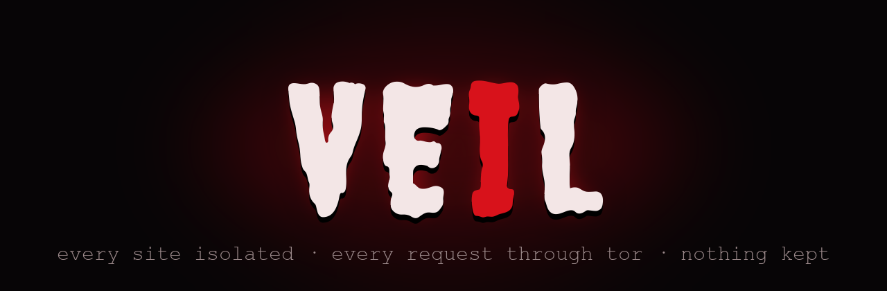
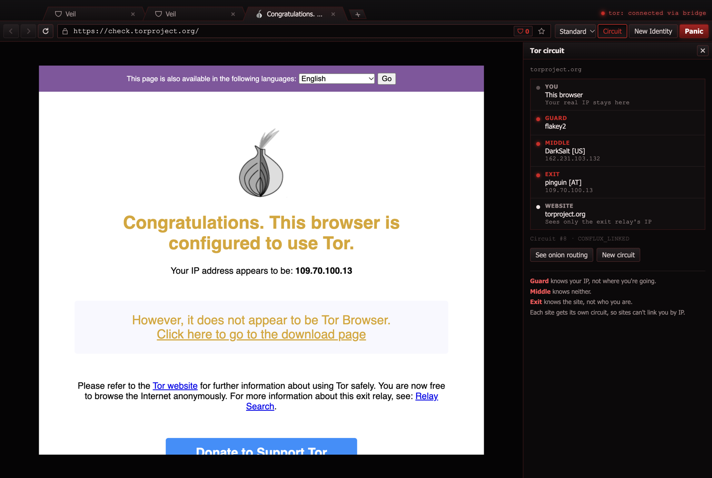
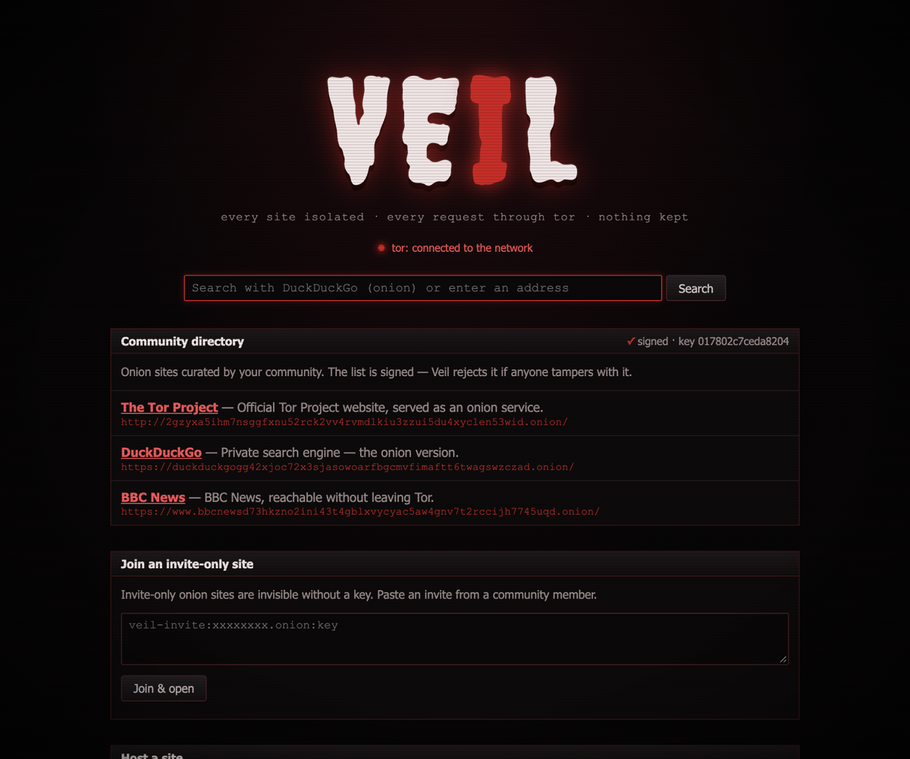
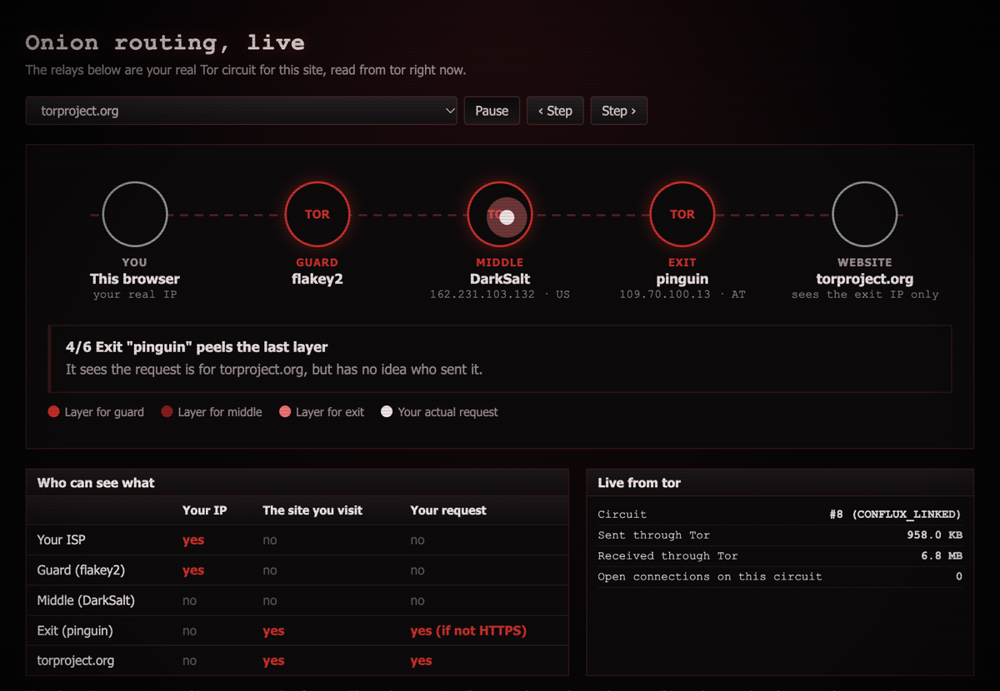
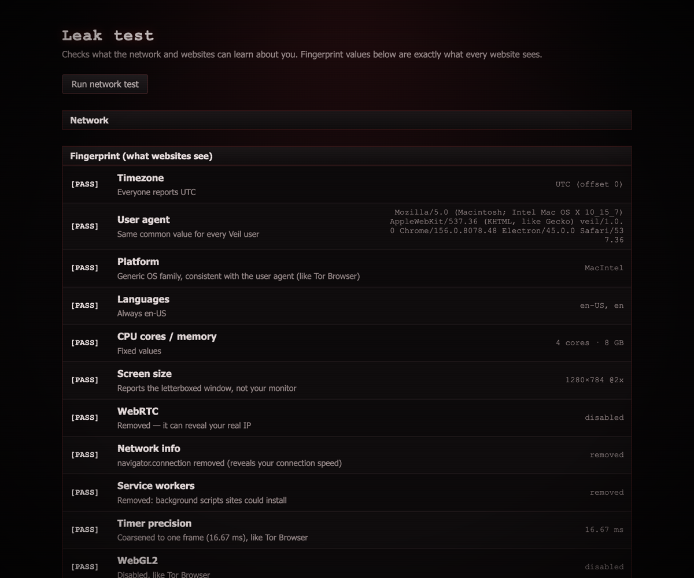

<p align="center">
  
</p>

<p align="center">
  <b>An anonymous browser inspired by Tor Browser, built by reverse engineering it.</b><br>
  Every request goes through the real Tor network, every site gets its own circuit, and nothing is kept.
</p>

<p align="center">
  <a href="https://github.com/nishant-Tiwari24/veil/actions/workflows/ci.yml"></a>
  <a href="https://github.com/nishant-Tiwari24/veil/releases/latest"></a>
  <a href="https://github.com/nishant-Tiwari24/veil/releases"></a>
  <a href="https://github.com/nishant-Tiwari24/veil/stargazers"></a>
  <a href="LICENSE"></a>
  
  
  
</p>

<p align="center">
  <a href="#download">Download</a> ·
  <a href="#screenshots">Screenshots</a> ·
  <a href="#features">Features</a> ·
  <a href="#how-we-reverse-engineered-tor-browser">Reverse engineering</a> ·
  <a href="docs/ARCHITECTURE.md">Architecture</a>
</p>

<p align="center">
  
</p>

> ⚠️ **Disclaimer — read this first**
>
> Veil is an **educational project** . It has **not** been
> security-audited. If your safety depends on staying anonymous (journalists,
> activists, whistleblowers), **use [Tor Browser](https://www.torproject.org/)**,
> not Veil.
>
> - Veil's fingerprint protection is weaker than Tor Browser's. It is built on
>   Chromium and has very few users, so it doesn't blend into a large crowd.
> - No browser can protect you if you log in to personal accounts or share
>   identifying details.
> - Tor protects your privacy; it does not make illegal activity legal. Follow
>   the laws where you live. The authors are not responsible for misuse.
> - Veil is not affiliated with or endorsed by The Tor Project. "Tor" is a
>   trademark of The Tor Project, Inc.

## Download
Grab the latest build from **[Releases](https://github.com/nishant-Tiwari24/veil/releases/latest)**:

| Platform | File | Notes |
|---|---|---|
| macOS (Apple Silicon) | `Veil-<version>-mac-arm64.dmg` | Unsigned: right-click → **Open** the first time |
| macOS (Intel) | `Veil-<version>-mac-x64.dmg` | Same as above |
| Linux | `Veil-<version>-linux-x86_64.AppImage` | `chmod +x`, then run |

Veil drives the real tor daemon, so install it first: `brew install tor` (macOS) or `sudo apt install tor` (Linux).
Release builds include lyrebird for bridges, taken from the signed Tor Browser release.

## Run from source
```bash
brew install tor          # Veil drives the real tor daemon
npm install
npm run bridges:setup     # optional: copies lyrebird from Tor Browser for bridges
npm start
```
Prove the anonymity guarantees automatically (37 checks against the live Tor network):
```bash
npm run selftest
```

## Screenshots
<table>
  <tr>
    <td><br><sub><b>Home:</b> signed community directory, invite-only sites, one-click onion hosting</sub></td>
    <td><br><sub><b>See onion routing:</b> your real circuit, one layer peeled per relay</sub></td>
  </tr>
  <tr>
    <td><br><sub><b>.onion sites:</b> BBC News over a Tor onion service</sub></td>
    <td><br><sub><b>Leak test:</b> what a website can learn about you</sub></td>
  </tr>
</table>

## Features

**Everyday browsing**
- Tabs: new, close, drag to reorder, right-click menu (duplicate, close others), reopen closed tab (⌘⇧T), ⌘1–9, Ctrl+Tab
- Address bar that searches privately (DuckDuckGo's onion) and shows your search terms, with suggestions from this session
- Back / forward / reload / stop, Home (⌘⇧H), favicons (fetched through Tor)
- Find in page (⌘F, ⌘G), zoom (⌘+ / ⌘− / ⌘0), print (⌘P), full-screen video
- Right-click menu: open link in new tab, copy link, search selection, copy/paste, inspect
- Bookmarks (⌘D), saved only if you choose to; Panic deletes them
- History (⌘Y), kept in memory for this session only
- Downloads through Tor, with a warning before saving
- Works with normal websites **and** .onion sites; shows ".onion available" when a site has an onion version

**Anonymity**
- All traffic through Tor, with a kill switch (no Tor = nothing loads)
- Per-site Tor circuits and storage: sites can't link you
- No local DNS, no WebRTC, no QUIC: no leaks around Tor
- Amnesic: nothing written to disk
- Fingerprint resistance (matched to Tor Browser): per-OS generic UA, UTC timezone, letterboxing, 16.67 ms timers,
  canvas noise, WebGL masking, no WebGL2 / network info / service workers
- HTTPS-Only mode, onion addresses never leak via Referer, specific onion error messages
- Security levels: Standard / Safer / Safest (JavaScript off)
- Live circuit map, New Identity (⌘⇧U), New Circuit (⌘⇧L), **Panic** (⌘⇧X)
- **See onion routing** (⌘⇧O): an animated view of your real circuit, with a packet
  losing one encryption layer per relay, who-sees-what, and live traffic from tor
- **Ad & tracker blocking** (EasyList + EasyPrivacy): the same built-in list for
  every user so it can't fingerprint you; shield badge shows the count, click to
  allow ads on a site for this session
- Built-in leak test
- Community Hub: signed directory, invite-only sites, one-click onion hosting

## Do I still need a VPN?
Not for browsing **inside Veil**: every page already goes through 3 Tor relays,
which hides your IP from websites and hides the sites you visit from your ISP.
But Veil only protects Veil. Other apps on your computer are not covered.

Some websites block or challenge Tor users (CAPTCHAs, banking, some Google
services). That is the site refusing Tor, not a Veil bug. Use ⌘⇧L (new circuit)
to try a different exit relay.

If your country or network blocks Tor itself, connect through a bridge (obfs4,
Snowflake or meek) from the Connection section on the home page.

## How we reverse engineered Tor Browser
We downloaded and verified Tor Browser 15.0.26, unpacked its app bundle and
`omni.ja`, read its 455 hardening prefs and its tor-control, isolation,
New Identity and security-level code, and measured its fingerprint side by
side with Veil. Findings and the fixes they led to:
**[docs/REVERSE_ENGINEERING.md](docs/REVERSE_ENGINEERING.md)**.

## Docs
- [Reverse engineering](docs/REVERSE_ENGINEERING.md) · [Plan](docs/PLAN.md) · [Architecture](docs/ARCHITECTURE.md) · [ADRs](docs/adr) · [TODO](docs/TODO.md)

## Updating the ad-block list
```bash
npm run adblock:update   # rebuilds assets/adblock.engine; do this before each release
```

## Community directory
```bash
npm run community:keygen   # once, creates the signing key (keep community.key secret)
# edit community/directory.json
npm run community:sign     # re-sign after every change
```

## Star history
<a href="https://star-history.com/#nishant-Tiwari24/veil&Date">
  <picture>
    <source media="(prefers-color-scheme: dark)" srcset="https://api.star-history.com/svg?repos=nishant-Tiwari24/veil&type=Date&theme=dark">
    
  </picture>
</a>

## Licence
[MIT](LICENSE). Bundled: [Creepster](assets/fonts/Creepster-OFL.txt) font (SIL OFL); release builds also ship
lyrebird from the Tor Project (BSD, licence included next to the binary).
